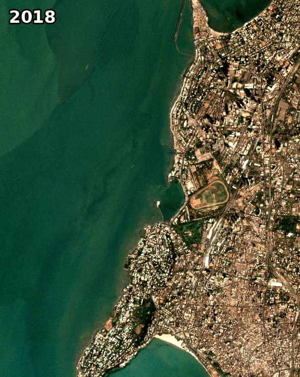
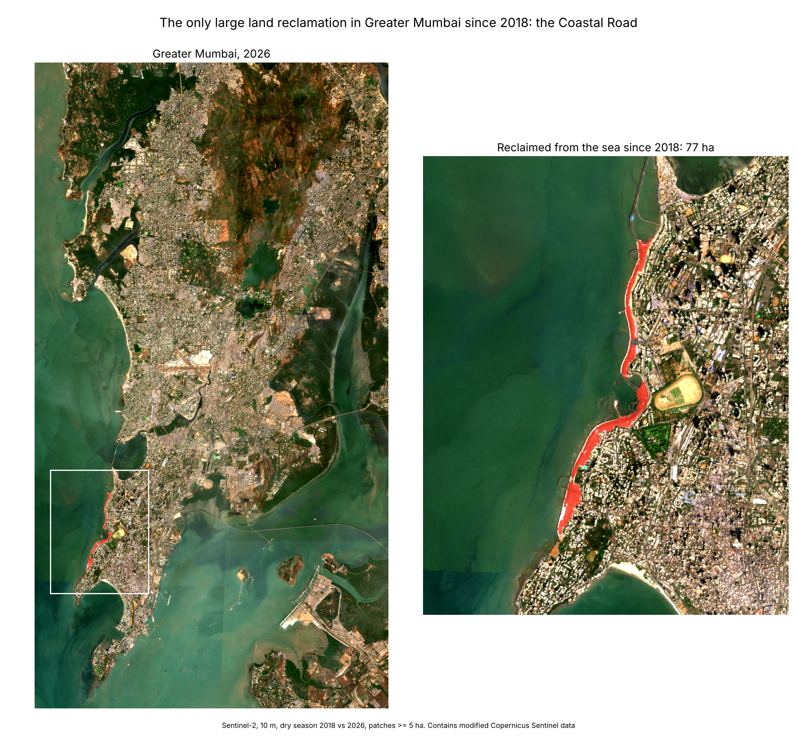

# Mumbai from Space

**How much land has Mumbai taken from the sea since 2018? Measured from free satellite imagery, pixel by pixel.**



## Finding

Comparing every 10 m pixel of Greater Mumbai in the 2018 and 2026 dry seasons:

- **The Coastal Road is the only land reclamation larger than 5 ha in the entire city.** It runs in four segments from Priyadarshini Park to Worli.
- **Measured: ~77 ha. Official figure: 111 ha** ([Coastal Road project](https://en.wikipedia.org/wiki/Coastal_Road_(Mumbai))). The satellite measurement undercounts for the reasons under *Limitations*. Across the scene sets and rule variants I tried, it ranged from 77 to 96 ha.
- **Next largest: 4.4 ha** off Bandra, which is a construction platform for the Bandra–Versova Sea Link (confirmed by eye).
- Reclamation work started in October 2018, so the Jan–Apr 2018 images are a clean "before".



## How it works

1. **Imagery.** For each period, the 6 least-cloudy days of Sentinel-2 Level-2A (10 m) from Jan–Apr are used, so the monsoon is avoided. Clouds and shadows are masked with the scene classification layer.
2. **Water or land, per scene.** A pixel is water if MNDWI = (green − SWIR) / (green + SWIR) > 0.
3. **Reclaimed.** A pixel counts as reclaimed only if all three hold:
   - In 2018 it was wet in at least one scene, so intertidal shore counts as sea. It must also belong to a water body connected to the open sea or creeks, which excludes lakes like Powai and Vihar.
   - In 2026 it is dry in **every** scene.
   - In 2026 it is bare or built, with NDVI < 0.2.
4. **Clean-up.** Single-pixel speckle is removed, and patches under 5 ha are dropped. Patches of 2–5 ha are written to `sites.json` as unverified.
5. **Boundary.** Mumbai City + Mumbai Suburban districts, buffered 300 m so that new land past the old coastline still counts.

The NDVI test matters. Without it, the first pass flagged ~28 ha of "new land" on Thane creek and at Mahul. Those patches read NDVI ≈ 0.65, meaning they are vegetation (most likely mangroves spreading over mudflats), not fill. The Coastal Road fill reads ≈ 0.04.

## Limitations

- **Edges are undercounted.** The SWIR band is 20 m, so pixels along the new seawall mix sea and land and flicker between wet and dry. The rule that 2026 land must be dry in *every* scene is strict on purpose, which costs some edge pixels. That is the main reason for 77 ha measured vs 111 ha official.
- **Tides.** Sentinel-2 passes at the same time of day, so a run of low-tide scenes can make mudflats or rock platforms look like new land. The NDVI test and the strict rule removed every case I checked by eye, but the 2–5 ha patches have not been verified.
- **Structures on piers are not land.** Atal Setu and the sea links stand on pillars, so they are (correctly) not counted.
- The results depend on which scenes are picked; see the 77–96 ha range above.

## Run it

```bash
pip install -r requirements.txt
python find_reclamation.py   # full city: prints sites, writes images/ and sites.json
python before_after.py       # quick before/after of the Coastal Road stretch
```

The first run downloads about 12 full-city scenes, which takes 5–10 minutes. After that it uses `city_cache.npz`. No account or API key is needed.

## Data and credits

- Imagery: contains modified Copernicus Sentinel data (2018, 2026), accessed through [Microsoft Planetary Computer](https://planetarycomputer.microsoft.com/dataset/sentinel-2-l2a). Scenes from 2022 onward have ESA's +1000 reflectance offset removed.
- Boundary: [geoBoundaries](https://www.geoboundaries.org/) gbOpen IND ADM2, CC BY 4.0.
- Code: MIT, see `LICENSE`.
