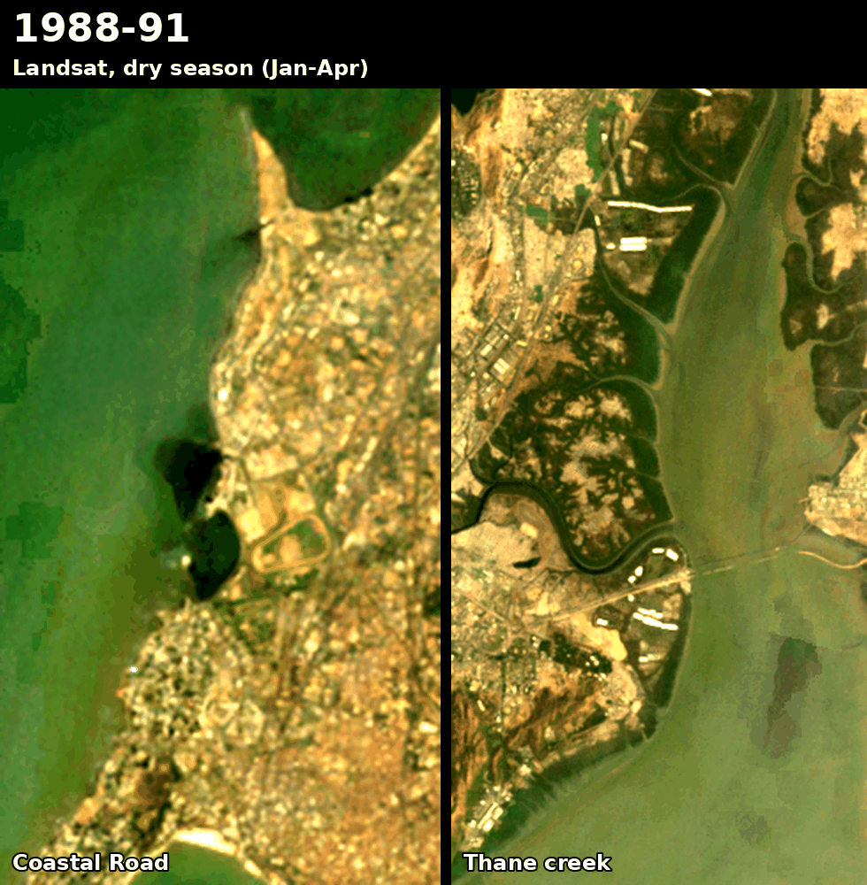
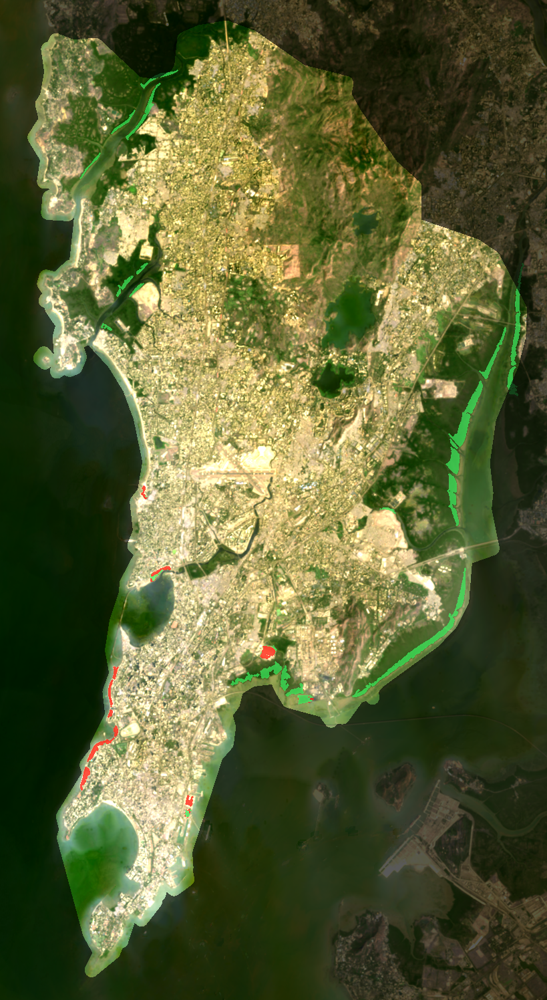

# Mumbai from Space

**How much land has Mumbai taken from the sea? Measured from free satellite imagery, pixel by pixel: since 2018 at 10 m with Sentinel-2, and since 1988 at 30 m with Landsat.**



## 1988–2026: 36 years with Landsat

Comparing 30 m Landsat imagery from the 1988–91 dry seasons with 2026, within Greater Mumbai:

- **About 150 ha of land has been built on water since 1988–91, and more than half of it is the Coastal Road** (83 ha, consistent with the 10 m Sentinel-2 measurement below). Almost nothing large was built on water between 1991 and 2018.
- The rest is smaller works: likely the Bandra end of the Bandra–Worli Sea Link (15 ha, early 2000s), port works on the eastern waterfront (14 ha, around 2014), a water body east of Wadala filled between 2022 and 2026 (28 ha, not yet identified), and 7 ha off Khar.
- **Mangroves spread over about 830 ha** of what was open water or mudflat in most 1988–91 scenes. That is about 5½ times the area built on. Most of it lies along the western shore of Thane creek and on the Sewri mudflats, with more in the Malad and Gorai creeks. The five largest sites were checked by eye.

Built land, by the period in which it first appeared and stayed:

| Period | Hectares |
| --- | ---: |
| 1993–95 | 0 |
| 1997–99 | 1 |
| 2001–03 | 15 |
| 2005–07 | 4 |
| 2009–11 | 2 |
| 2014 | 9 |
| 2018 | 2 |
| 2022 | 72 |
| 2026 | 44 |



### How it differs from the Sentinel-2 method

1. **Imagery.** Landsat 5, 7, 8 and 9 (Collection 2, Level-2). For each period, up to 8 of the least-cloudy Jan–Apr scenes are used. Scenes before 2014 are sparse, so the early periods pool three or four years. Clouds and shadows are masked with the `QA_PIXEL` band.
2. **Sea in 1988–91** means water in **at least half** of the clear scenes, not just one. At 30 m, rocky shore and flooded mangroves read as water at high tide. With the looser rule, false "new land" grew to 2,100 ha.
3. **Land in 2026** means dry in every clear 2026 scene. NDVI splits new land into bare or built (< 0.2) and vegetated.
4. **Dating.** Each pixel is dated to the first period from which it stayed land.
5. **Clean-up.** Patches under 5 ha are dropped. Results go to `sites_1988_2026.json`.

### Limitations

- **30 m is coarse.** Thin features and edges are lost, and only patches of 5 ha or more count.
- **The record starts in 1988.** That is the earliest clear dry-season Landsat scene of Mumbai in the archive, so the city's older reclamations are not covered.
- **"Mangroves" rests on NDVI and visual checks.** It is not a species map.
- **Landsat 7 stripes.** After 2003, Landsat 7 images have scan-line gaps. They are used for the water maps but left out of the colour frames, and the 2005–07 and 2009–11 periods are not shown in the timelapse.

## 2018–2026: the Coastal Road at 10 m (Sentinel-2)


Comparing every 10 m pixel of Greater Mumbai in the 2018 and 2026 dry seasons:

- **The Coastal Road is the only land reclamation larger than 5 ha in the entire city.** It runs in four segments from Priyadarshini Park to Worli.
- **Measured: ~77 ha. Published figure: about 111 ha** ([Infralens](https://infralens.in/projects/mumbai-coastal-road)). The satellite measurement undercounts for the reasons under *Limitations*. Across the scene sets and rule variants I tried, it ranged from 77 to 96 ha.
- **Next largest: 4.4 ha** off Bandra, which is a construction platform for the Bandra–Versova Sea Link (confirmed by eye).
- Construction started in October 2018 ([Housing.com](https://housing.com/news/mumbai-coastal-road-everything-you-need-to-know/)), so the Jan–Apr 2018 images are a clean "before".


### How it works

1. **Imagery.** For each period, the 6 least-cloudy days of Sentinel-2 Level-2A (10 m) from Jan–Apr are used, so the monsoon is avoided. Clouds and shadows are masked with the scene classification layer.
2. **Water or land, per scene.** A pixel is water if MNDWI = (green − SWIR) / (green + SWIR) > 0.
3. **Reclaimed.** A pixel counts as reclaimed only if all three hold:
   - In 2018 it was wet in at least one scene, so intertidal shore counts as sea. It must also belong to a water body connected to the open sea or creeks, which excludes lakes like Powai and Vihar.
   - In 2026 it is dry in **every** scene.
   - In 2026 it is bare or built, with NDVI < 0.2.
4. **Clean-up.** Single-pixel speckle is removed, and patches under 5 ha are dropped. Patches of 2–5 ha are written to `sites.json` as unverified.
5. **Boundary.** Mumbai City + Mumbai Suburban districts, buffered 300 m so that new land past the old coastline still counts.

The NDVI test matters. Without it, the first pass flagged ~28 ha of "new land" on Thane creek and at Mahul. Those patches read NDVI ≈ 0.65, meaning they are vegetation (most likely mangroves spreading over mudflats), not fill. The Coastal Road fill reads ≈ 0.04.

### Limitations

- **Edges are undercounted.** The SWIR band is 20 m, so pixels along the new seawall mix sea and land and flicker between wet and dry. The rule that 2026 land must be dry in *every* scene is strict on purpose, which costs some edge pixels. That is the main reason for 77 ha measured vs 111 ha published.
- **Tides.** Sentinel-2 passes at the same time of day, so a run of low-tide scenes can make mudflats or rock platforms look like new land. The NDVI test and the strict rule removed every case I checked by eye, but the 2–5 ha patches have not been verified.
- **Structures on piers are not land.** Atal Setu and the sea links stand on pillars, so they are (correctly) not counted.
- The results depend on which scenes are picked; see the 77–96 ha range above.

## Run it

```bash
pip install -r requirements.txt

# 1988-2026 (Landsat)
python landsat_epochs.py        # downloads ~80 scenes into epochs/ (15-20 min the first time)
python coastline_1988_2026.py   # measures, writes images/ and sites_1988_2026.json

# 2018-2026 (Sentinel-2)
python find_reclamation.py      # full city: prints sites, writes images/ and sites.json
python before_after.py          # quick before/after of the Coastal Road stretch
```

No account or API key is needed. Downloads are cached, so later runs are fast.

## Data and credits

- Landsat imagery courtesy of the U.S. Geological Survey, accessed through [Microsoft Planetary Computer](https://planetarycomputer.microsoft.com/dataset/landsat-c2-l2).
- Sentinel-2: contains modified Copernicus Sentinel data (2018, 2026), accessed through [Microsoft Planetary Computer](https://planetarycomputer.microsoft.com/dataset/sentinel-2-l2a). Scenes from 2022 onward have ESA's +1000 reflectance offset removed.
- Boundary: [geoBoundaries](https://www.geoboundaries.org/) gbOpen IND ADM2, CC BY 4.0.
- Code: MIT, see `LICENSE`.
